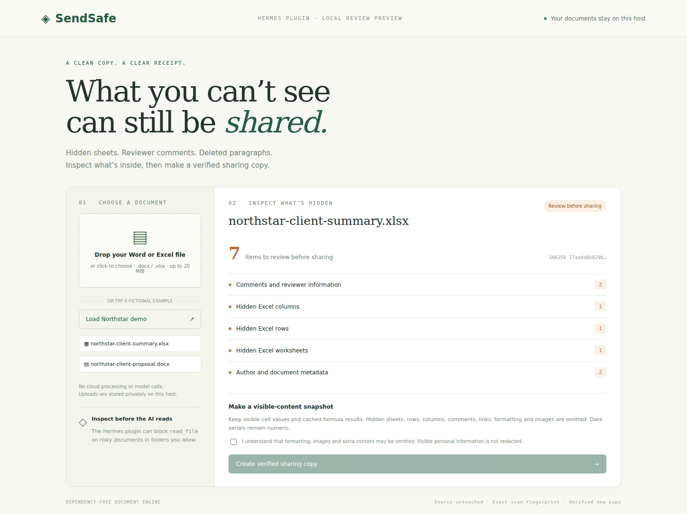
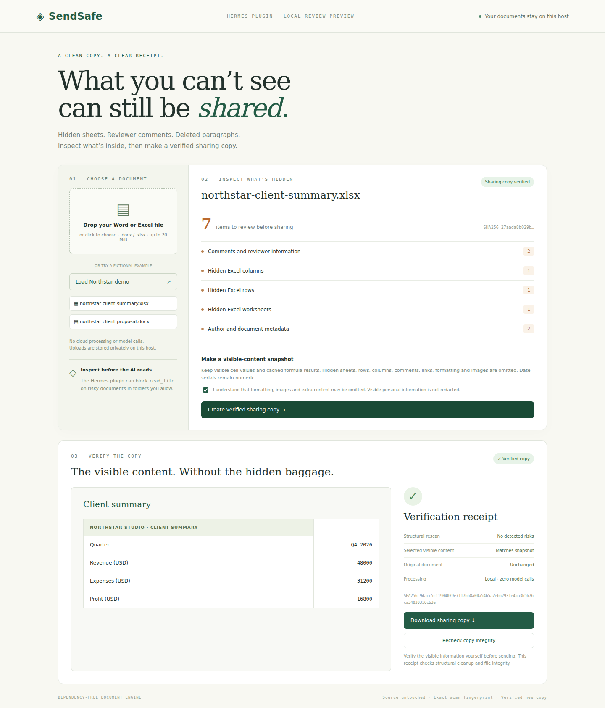

# SendSafe

**Hermes Plugin Catalog Pull Request: [NousResearch/hermes-agent#154049](https://github.com/NousResearch/hermes-agent/pull/154049)**

**What you can’t see can still be shared.** SendSafe gives Hermes a local privacy checkpoint for Word and Excel documents: inspect hidden content, prepare a separate sharing copy, and verify that copy before sending it.



## What it does

- Finds hidden Excel sheets, rows and columns; Word hidden text and tracked deletions; reviewer comments; author metadata; and embedded or linked content.
- Reports structural findings and counts without returning hidden text, hidden cell values, or author names to the model.
- Builds a new `.docx` or `.xlsx` containing selected visible content, verifies its structure and content, and writes a SHA-256 receipt. The source stays byte-for-byte unchanged.
- Can block Hermes’s `read_file` tool on risky documents in explicitly allowed folders before that tool reads their content.
- Includes a Hermes Desktop review page, three agent tools, and an authenticated local browser preview.

## Install in Hermes

Requires Hermes **0.23.0 or later** and Python **3.11 or later**. The document engine uses the Python standard library; it needs no model, API key, or third-party document-processing service.

```bash
hermes plugins install https://github.com/NSEVEjk0/hermes-sendsafe
hermes plugins enable sendsafe
```

Set allowed folders in your active Hermes profile’s `config.yaml`, then restart Hermes:

```yaml
plugins:
  enabled: [sendsafe]
  entries:
    sendsafe:
      settings:
        allowed_roots:
          - /absolute/path/to/documents
        guard_reads: true
```

The Desktop page also accepts uploads and provides fictional Northstar demo documents. Uploads are copied to the selected Hermes host; on a remote gateway, processing takes place on that remote host. Plugin-owned input, demo, and export folders are allowed automatically.

Ask Hermes: “Inspect this client workbook with SendSafe before reading it. Tell me what needs review, then ask me before preparing a sharing copy.”

| Tool | Purpose |
| --- | --- |
| `sendsafe_inspect(path)` | Return findings and the exact source fingerprint. |
| `sendsafe_prepare(path, expected_sha256)` | Build and verify a separate sharing snapshot; refuse a changed source. |
| `sendsafe_verify(export_id)` | Recheck the copy and its receipt; refuse a tampered export. |

## Try the browser review

```bash
git clone https://github.com/NSEVEjk0/hermes-sendsafe
cd hermes-sendsafe
python3 scripts/serve_demo.py --port 8777
```

Open the private localhost URL printed by the server. Click **Try fictional Northstar demo**, inspect the findings, acknowledge the snapshot limits, and create a verified sharing copy. Review the visible preview before downloading. This browser preview exercises the same engine as the plugin; it is separate from native Hermes Desktop.



## Snapshot limits

This is a visible-content snapshot, so review it before use. Word retains visible body text and tables, accepts inserted text, and omits deleted or hidden text, comments, headers, footers, images, and original formatting. Excel retains visible cell values and cached formula results, omitting hidden sheets, rows, columns, formulas, comments, links, images, and original formatting. An uncached visible formula is refused instead of inventing its result. Excel dates can appear as numeric serial values.

Visible personal or confidential information is **not automatically redacted**. The read guard covers only Hermes `read_file` in allowed or plugin-owned folders; terminal commands, MCP tools, direct model attachments, and other sharing routes are outside its scope. Nothing is sent automatically. SHA-256 receipts check structural cleanup and file integrity; they are not signed provenance or a security audit.

## Processing and storage

Document processing makes no network calls. The engine uses bounded ZIP/XML reads without archive extraction and rejects dangerous XML declarations, oversized inputs, duplicate parts, and traversal paths. Exports use private permissions, exact source fingerprints, and tamper checks.

The plugin stores uploaded documents, fictional fixtures, sharing copies, and receipts in Hermes’s profile-aware SendSafe data directory. Delete files there when no longer needed. The local preview stores the same data under `.local/review-data` by default and binds only to `127.0.0.1`, with a random access token. No telemetry or credentials are stored. Native dashboard operations invoke a bounded Python child process running only the plugin’s own document engine; the explicitly launched browser preview is a foreground server.

## Verification

```bash
python3 -m unittest discover -s tests -v
```

Thirty tests cover hidden-content canaries, source preservation, stale scans, tampering, allowlists, symlinks, private permissions, formula caches, malformed archives/XML, traversal, and processing limits. `scripts/check-hermes.py` additionally exercises the actual upstream Hermes loader, registered tool dispatcher, and `pre_tool_call` hook against an isolated profile, without calling a model. `npm run test:e2e` checks the browser workflow with Playwright after installing the development dependency.

The Hermes integration check passed for both formats: risky original reads were blocked, verified-copy reads were allowed, and changed copies were refused. The final upstream catalog validator passed all checks; its one warning identifies the integration test’s import of the actual core loader, outside the plugin runtime. The browser checks passed for Word and Excel inspection, consent, export, preview, download, reverification, invalid uploads, and authentication. Native Desktop rendering and a live model-driven conversation have not been exercised here.

MIT licensed. Built for the Hermes Agent Plugin Hackathon.
